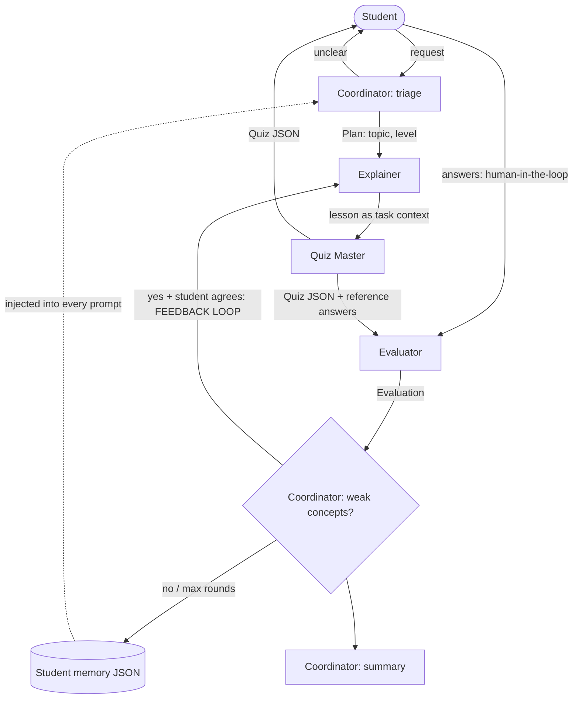

# 🦁 Leo — Multi-Agent AI Tutor

Leo is a study assistant built with **CrewAI**. Four agents with separate roles, prompts and behaviours
collaborate to plan, teach, quiz and grade a student, with real handoffs between them.

## Agents
| Agent | Role | Output |
|---|---|---|
| **Coordinator** | Reads the request, handles vague input (asks one clarifying question), routes work, retries failed steps, triggers re-teaching, writes the summary | `Plan` (structured) |
| **Explainer** | Teaches the concept with analogies/examples; uses a different approach when re-teaching | Lesson text |
| **Quiz Master** | Writes questions from the Explainer's lesson | `Quiz` (Pydantic, structured) |
| **Evaluator** | Grades answers with partial credit, feedback, weak-concept detection; has a **calculator tool** | `Evaluation` (structured) |

Prompts: `prompts.py` (one role prompt + one task template per agent). Memory: `memory.py`.

## Architecture


## Orchestration pattern
**Coordinator-driven sequential pipeline with a feedback loop.**
CrewAI `Process.sequential` crews run each stage; Explainer→Quiz Master uses CrewAI task `context=` (true
handoff), and Quiz Master→Evaluator passes the structured `Quiz` JSON. The Coordinator owns control flow:
clarification, retries (`max_iter`, `max_execution_time`, retry with back-off), and routing weak answers back
to the Explainer (up to 3 rounds).

## Bonus features
- **Feedback loop:** Evaluator's `weak_concepts` → Coordinator → Explainer re-teaches → new quiz.
- **Human-in-the-loop:** student answers each question, can `/skip`, `/quit`, and approves re-teaching.

## Memory
Per-student JSON (`data/memory/`, git-ignored): past topics, scores, recurring weak concepts. Injected into
every agent's prompt via the `{memory}` placeholder.

## Run
```bash
python -m venv .venv && source .venv/bin/activate
pip install -r requirements.txt
cp .env.example .env        # add your API key (never commit .env)
python main.py
```
Any LiteLLM model works via `LEO_MODEL` (e.g. `gemini/gemini-2.0-flash`).

## Graceful failure handling
Vague request → Coordinator asks (max 2×). Agent error/stall/invalid JSON → retry with back-off, then a safe
message. Corrupt memory file → starts fresh.

## Demo video script (3–5 min)
1. (0:00) Show repo + README diagram, 20 s.
2. Run `python main.py`, name "Asha", type "help me study" → Coordinator asks a clarification.
3. Answer "photosynthesis" → show Coordinator plan, Explainer lesson, handoff to Quiz Master.
4. Answer questions — get 1–2 wrong on purpose. Show Evaluator feedback.
5. Say `y` to re-teach → show Explainer's new explanation + second quiz (feedback loop).
6. Show summary, then `data/memory/asha.json`. Restart to show memory ("Returning student").
